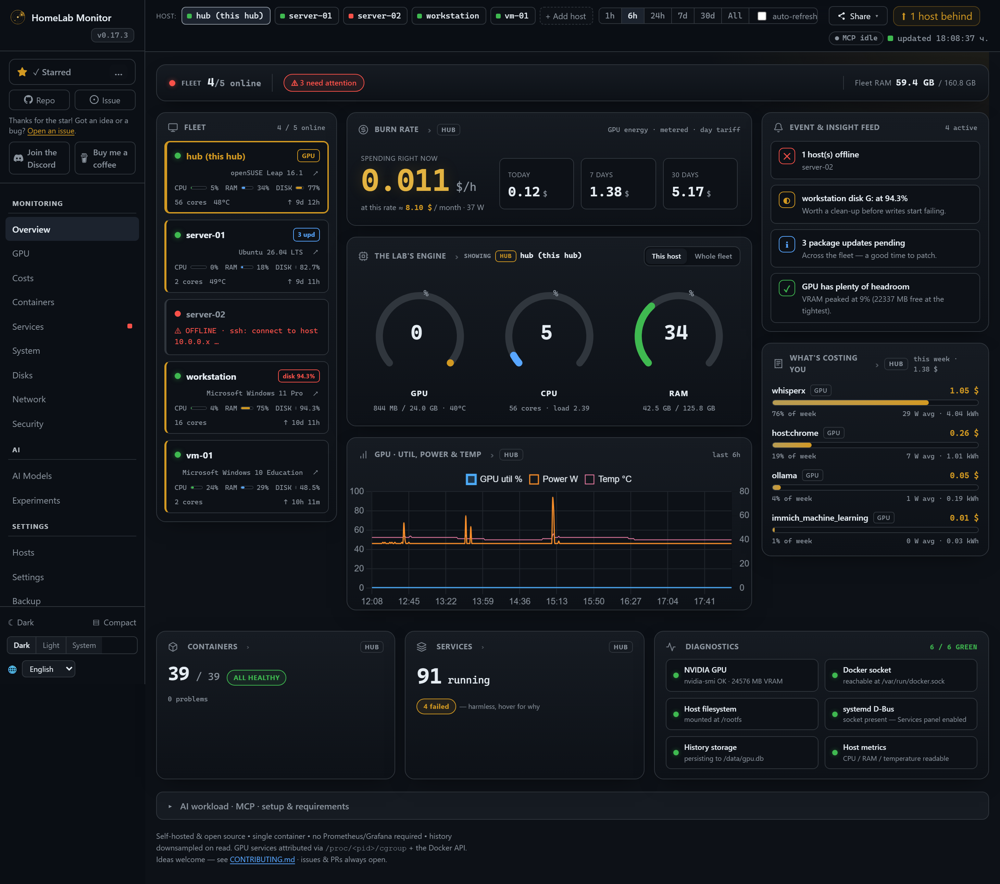

# Features — a tab-by-tab tour

A **host pill bar** at the top switches between the local box and any remote you've
registered; every tab scopes to the active host. Here's what each one shows.

The sidebar is yours to arrange: **✎ Customize** at its foot lets you drag tabs into the
order you use them and hide the ones you don't (saved per browser, reset from
**Settings → General**). A hidden tab still opens from search or a link.

??? tip "Screenshots are from a live 56-core / RTX 3090 host"
    Network identifiers are redacted; everything else is real data.

## Overview

Every registered host side by side: CPU % + cores, RAM % + GB, GPU util + VRAM,
load, uptime, temperature and disks. Click a row to focus that host in the other tabs.

## GPU

Live VRAM / utilisation / power / temperature, **which container or process holds the
VRAM** (mapped automatically via `nvidia-smi` + `/proc/<pid>/cgroup` — nothing
hardcoded), and a VRAM-by-service timeline.

## AI Models

Every recognised model server (Ollama, vLLM, llama.cpp, ComfyUI, faster-whisper,
Stable Diffusion, …), **which model is loaded** and its VRAM — read live from the
server's own API. Servers stay listed as **Idle** when their model unloads (nothing
flickers away), and a **"Driven by"** breakdown shows which services are calling each
server. See the [full list of 30+ servers](model-servers.md).

## Hall of Fame

Every model that has held this host's GPU over the selected range, ranked by how long
it stayed **loaded** — residency, not utilisation, so a model idling in VRAM still
counts. The longest-resident model gets the hero card; the rest follow in a ranked
table with their share of the range and when they were last seen.
(Contributed by [@haigou-web](https://github.com/haigou-web).)

## Benchmark Lab

Measure what your local models **actually** do on your GPUs, instead of guessing.
Pick one or more ollama models and the Lab sweeps a ladder of context sizes,
recording **generation & prompt tokens/sec**, load time, the **VRAM↔RAM split**
(how much spilled to system RAM), a fit verdict, and the **largest context that
still fits fully in VRAM** — the cap worth setting. Choose which GPU(s) to test
(via a throwaway pinned ollama container — your main one is never touched),
overlay stored runs to compare cards, and every run is priced by the same tariff
engine as the rest of the app. Results are stored and sortable in a filterable
table: benchmark once, re-run only when something changes. Benchmarking is an
active, opt-in operation and single-flight, so it never stampedes the GPU.
It benchmarks the ollama you registered under **Settings → AI servers** (the same one
the connectivity Test checks); set `COPILOT_OLLAMA_URL` to point it elsewhere.

## Costs

Set an electricity price (one flat rate, or day and night) under **Settings → Costs**
and power turns into money: what today, the last 7 and the last 30 days cost, power
over time split into GPU, CPU and DRAM (measured, CPU/DRAM via RAPL where readable),
and a ranked breakdown by process, container and model with a drill-down for each.
**Energy used** charts the kWh the machine actually consumed — hour by hour for the
last week, or day by day for the last three months — with the cost alongside, so a
heavy night or a quiet weekend stands out; gaps mark times nothing was recorded.
**Busy hours** folds the same history into an average week (day × hour) to show when
your lab usually burns power. Both work per host and without a price set (energy only).

## Containers

Health of **every** Docker container with uptime, **RAM and GPU-VRAM in separate
columns** (RAM is the real resident set — page cache excluded — so the numbers add
up), real on-disk footprint, a **table total**, and clickable port chips that open
`host:port` in a new tab. Start, stop, restart and change the restart policy of
local containers straight from the table — on by default, see
[`ENABLE_CONTROLS`](configuration.md#write-actions-allow_self_update-enable_controls)
to turn it off. Windows hosts with Docker Desktop fill this tab too.

## Services

**systemd** service health for the active host (local *or* remote), with the units
*you* deployed highlighted, any failed unit surfaced first, plus per-unit uptime,
memory, and listen ports. Start/stop/restart is on by default too — for the
local host and for any registered remote (Linux or Windows) — see
[`ENABLE_CONTROLS`](configuration.md#write-actions-allow_self_update-enable_controls)
to turn it off.

## System

CPU, RAM, load, uptime, temperature and disk usage, **plus** a full inventory panel:
OS + version, kernel, architecture, init system, bare-metal/VM detection, machine
model, CPU model & topology, and GPU. A **Memory map** treemap shows exactly what's
using RAM — grouped by **container** and by **systemd service** — so it's useful even
on a box with no Docker.

## Disks

A **WizTree-style treemap** per filesystem: scan a disk and see what's eating the
space as nested rectangles (top folders **and** their sub-folders in one view), then
click any folder to drill deeper. On-demand and cached, so it never hammers your disks
in the background.

## Network

Per-host interfaces (IPv4/IPv6, MAC, link state, speed, MTU, RX/TX), default gateway,
DNS resolvers, and a listening-socket table that flags which ports are bound to **all
interfaces** vs localhost.

## Security

A read-only posture check per host: firewall (ufw / firewalld / nftables), SSH
hardening (root login / password auth), SELinux/AppArmor, fail2ban, reboot-pending and
auto-updates — **issues surfaced first**, with anything that needs root to read marked
clearly rather than guessed.

## Hosts

A registry and clean three-step onboarding: authorize the hub's key (with the exact
command **for the remote's OS**), add a host — **Linux, a Raspberry Pi, or Windows** —
and run a per-capability **Test connection**. For anything not yet working it shows the
precise fix command for that machine's OS, and **▶ Run on remote** applies it without
leaving the dashboard. See [Multi-machine monitoring](multi-host.md).

---

History is stored in SQLite and **downsampled on read**, so a six-month view loads as
quickly and reads as cleanly as the last hour.
